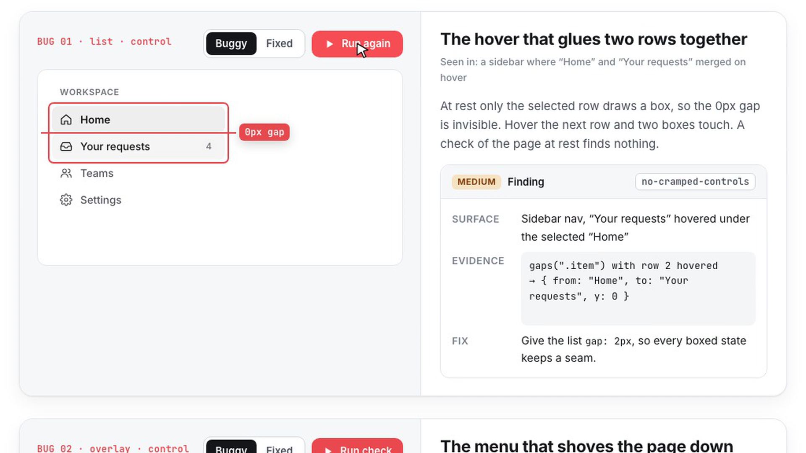

# UX Quality Check

A skill for Claude Code and Codex that checks the UX of a UI change. After your agent edits UI
code, the skill finds the surfaces the diff touches and checks each one against a catalog of 52
common UX defects. It reads the code and, when a dev server or a static page and a browser tool are
available, measures the live page at rest, on hover and on keyboard focus. Each finding has a
surface, a rule, measured evidence and a fix.

[](https://ktmud.github.io/ux-quality-check-skill/tour.mp4)

▶ [Watch the promo](https://ktmud.github.io/ux-quality-check-skill/tour.mp4) ·
[Try the live demo](https://ktmud.github.io/ux-quality-check-skill/): ten real-world bugs, each a
mini-app you can measure, break and fix in the browser.

## Install

Claude Code:

```bash
claude plugin marketplace add ktmud/ux-quality-check-skill
claude plugin install ux-quality-check@ux-quality-check
```

Codex:

```bash
codex plugin marketplace add https://github.com/ktmud/ux-quality-check-skill
codex plugin add ux-quality-check@ux-quality-check
```

Then, after a UI change, ask your agent to "check the UX of this change".

## What it checks

| Group | Examples |
| --- | --- |
| Feedback and state | a write button with no pending state, "No results" while data loads, typed text lost after a failed save, a disabled control that does not say why, an error that does not lead to a fix |
| Layout and spacing | a block with no gutter, two boxed items that touch on hover, a column with two right edges, a menu that pushes content down, a toggle that moves when you click it, overflow, cut-off scroll areas, phone layouts |
| Controls and icons | an icon that misleads, a control that does nothing, two controls for one concept, hover-only controls, native browser dialogs |
| Content and forms | filler copy, labels that do not name the action, unsafe defaults, two views of one value that disagree, hidden filters, chart labels over data |
| Navigation | back and reload that lose the reader's place, page titles, section permalinks |
| Visual system | raw type values, theme contrast, edge stripes, nested boxes, row dividers with stray rounded corners |

The full catalog is in [`references/rules.md`](skills/ux-quality-check/references/rules.md). Each
rule has a reason, a check in code, a check in the browser and a fix. Each rule also lists the
kinds of change it applies to (`write`, `form`, `list`, `overlay`, `layout` and others), so the
skill runs only the rules that match what the diff changed.

## How it works

1. **Find the change.** The skill reads the diff. With no UI file in it, it says so and stops.
2. **Map the surfaces.** It maps each changed file to the views and controls a user sees, and tags
   each surface with its kinds of change.
3. **Read the repo's own rules.** A repo's UI rules, design-system components and UX checks take
   priority over the catalog's defaults. A fix names the repo's own component.
4. **Read, then measure.** It reads the code first. Then it loads
   [`scripts/measure.js`](skills/ux-quality-check/scripts/measure.js) into the page and measures
   gaps, insets, edges, overlap, overflow, contrast and layout shift, before and after each hover,
   focus, open and toggle.
5. **Check and report.** It checks each finding once more and reports defects that the change did
   not add in a separate list.

The rules are stack-neutral, with React and CSS examples.

## Add a rule

Add a section to `references/rules.md` with a stable id, the rule, why, a check in code, a check
in the browser and a fix. Add the id to the table at the top of that file, in its group, with the
kinds of change it applies to in the "Applies to" column.

A browser check that needs a new measurement goes in `scripts/measure.js` as a helper on `window`,
with a row in the helper table of `references/rules.md`. Load the file twice in one page to
confirm that a second load keeps the saved snapshots.

## License

[MIT](LICENSE)
